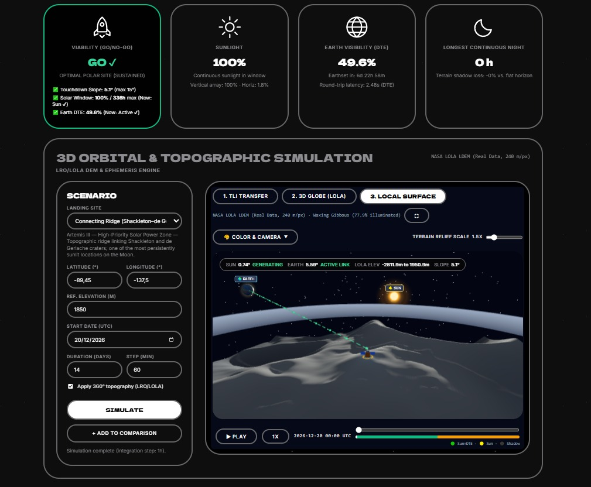

# ☾ UrbanAstro

### Lunar South Pole Lighting, Terrain & Direct-to-Earth (DTE) Communication Decision Tool

[](https://www.spaceappschallenge.org/)
[](https://www.python.org/)
[](https://fastapi.tiangolo.com/)
[](https://threejs.org/)
[](https://opensource.org/licenses/MIT)
[](https://urbanastro.onrender.com)
[](./docs/UrbanAstro_Technical_Report.pdf)

**UrbanAstro** is a scientific mission-planning and public outreach web application built for the **NASA Space Apps Challenge** (*Lunar South Pole Lighting & Communication Tool*). It evaluates candidate landing sites and mission windows at the lunar south pole ($\phi \le -80^\circ\text{S}$) by combining real **NASA/JPL SPICE ephemerides** with **LRO/LOLA Digital Elevation Models (DEM)** to determine solar illumination, topographic shadowing, terrain slope, and Direct-to-Earth (DTE) line-of-sight communication.

---

## 📸 Visual Tour & Interface Gallery

> 💡 *Tip: Click any image to expand. Live interactive simulation available at [**urbanastro.onrender.com**](https://urbanastro.onrender.com).*

| **1. Mission Viability Dashboard & 3D Local Surface** | **2. 3D Lunar Globe (LRO/LOLA Polar Hillshade)** |
| :---: | :---: |
|  |  |
| *Real* $128 \times 128$ *LOLA DEM (*$36 \times 36\text{ km}$*) with real-time solar shadows, DTE telemetry beam, and GO/NO-GO cards.* | *Selenographic inspection with cached* $512 \times 512$ *LOLA polar hillshade cap and real-time Sun/Earth vectors.* |

| **3. Trans-Lunar Injection (TLI) Transfer View** | **4. Synchronized Elevation Timeline &** $360^\circ$ **Skyplot** |
| :---: | :---: |
|  |  |
| *Earth–Moon–Sun orbital geometry using true JPL `DE421` arrival vectors.* | *Interactive click-to-seek elevation timeline with green simultaneous operational windows and* $360^\circ$ *polar skyplot.* |

---

## 📄 Technical Engineering Report (LaTeX Paper)

For a complete derivation of the mathematical and geodetic models implemented in the **UrbanAstro** backend engine, read our full technical paper included in this repository:

👉 [**📄 Read the Technical Engineering Report (`docs/UrbanAstro_Technical_Report.pdf`)**](./docs/UrbanAstro_Technical_Report.pdf)

**What the report covers:**

1. **Topocentric Astrodynamics:** Vectorized transformations from the ICRF barycentric frame to the lunar body-fixed `MOON_ME_DE421` selenographic coordinate system.
2. **South Polar Stereographic Geodesy:** Forward projection equations ($\phi_0 = -90^\circ, R_{\text{Moon}} = 1{,}737.4\text{ km}$) and windowed affine GeoTIFF sampling.
3. $360^\circ$ **Curvature-Corrected Horizon Raycasting:** Vectorized $149{,}760$-point bilinear interpolation across a $100\text{ km}$ radius accounting for spherical lunar surface drop ($\Delta z_{\text{curv}} \approx 2{,}877.9\text{ m}$ at $100\text{ km}$).
4. **Touchdown Slope & Solar Array Geometry:** Native $240\text{ m/px}$ $5 \times 5$ median slope estimation ($P_{50}$) and vertical vs. horizontal solar collector efficiency under grazing polar illumination.

---

## 🚀 Key Features

- **High-Precision Ephemeris Engine (`de421.bsp`):** Computes topocentric Sun and Earth apparent elevation, azimuth, range, and lunar phase in the `MOON_ME_DE421` frame, accounting for the apparent solar disc semidiameter ($0.265^\circ$) and zero atmospheric refraction.
- **100% Real LRO/LOLA Topographic Engine (`LDEM_80S_240MPP_COMPACT.TIF`):**
  * **Polar Coverage (**$\phi \le -80^\circ\text{S}$**):** Extracts $360^\circ$ horizon obstruction profiles over a $100\text{ km}$ **radius**, $128 \times 128$ **3D elevation meshes** ($36 \times 36\text{ km}$ span), and native-resolution median touchdown slopes (`slope_deg`) from $240\text{ m/px}$ LRO/LOLA South Polar Stereographic GeoTIFF data.
  * **Reference Sphere Fallback (**$\phi > -80^\circ\text{S}$**):** Outside polar DEM coverage (e.g., Apollo 11 equatorial baseline), the engine disables synthetic 3D terrain and evaluates analytical horizon geometry without fabricating artificial relief.
- **Dual User Modes:**
  * 🛠️ **Engineer Mode:** Exposes custom selenographic coordinates, integration step controls, real-time `GO / NO-GO / INCONCLUSIVE` gate checks, vertical vs. horizontal solar array efficiency, DTE round-trip signal latency, and multi-scenario trade-off comparison.
  * 🚀 **Explorer Mode:** Translates complex orbital mechanics into intuitive visual explanations and guided takeaways for students and the general public.
- **Interactive 3D Orbital & Surface Simulation (React 18 + Three.js):**
  1. *Trans-Lunar Injection (TLI) Transfer View* (LEO departure, translunar coast, and LOI polar capture).
  2. *3D Lunar Globe View* (selenographic site pin with real LOLA polar hillshade overlay).
  3. *Local Surface View* (real-time shadow casting, `Natural / Elevation / Slope` heatmaps, camera presets `Lander POV / Crater Rim / Top-Down`, playback speed controls `1x/2x/4x`, and a visual operational window heatmap bar).
- **Bidirectional Scientific Charts (Plotly.js):**
  * Dynamic Sun & Earth elevation timeline with highlighted **Simultaneous Operational Windows** and a real-time synchronized cursor (**clicking any point on the chart seeks the 3D scene to that exact UTC timestamp**).
  * $360^\circ$ Polar Skyplot overlaying the local LOLA horizon mask against solar and terrestrial paths.

---

## 📍 Curated Lunar Landing Sites Catalog

**UrbanAstro** includes 7 pre-configured scientific and mission-relevant sites:

1. **Shackleton Crater Rim (`-89.90°, 0.00°`)** — Artemis III candidate region / Peak of Eternal Light adjacent to water-ice PSRs.
2. **Connecting Ridge (`-89.45°, -137.50°`)** — High-priority sunlit ridge linking Shackleton and de Gerlache craters.
3. **Malapert Massif (`-86.04°, -2.70°`)** — Elevated $4.7\text{ km}$ mountain massif ideal for lunar relay towers and solar arrays.
4. **Cabeus Crater Floor (`-84.90°, -35.50°`)** — LCROSS (2009) impact site / Permanently Shadowed Region (PSR) volatile target.
5. **Malapert A / IM-1 Odysseus (`-80.13°, 1.44°`)** — Intuitive Machines Nova-C (2024) commercial south polar landing region.
6. **Nobile Crater Rim (`-85.20°, 53.50°`)** — VIPER / Artemis candidate rover traverse region.
7. **Mare Tranquillitatis / Apollo 11 (`0.67°, 23.47°`)** — Equatorial historical baseline ($\sim 14\text{-day}$ sunlit / $\sim 14\text{-day}$ night cycle).

---

## 🏗️ System Architecture

```text
UrbanAstro/
├── backend_loader.py         # One-command automated setup (.venv, pip, SPICE/LOLA download & Uvicorn launch)
├── requirements.txt          # Python scientific & web dependencies
├── docs/
│   ├── UrbanAstro_Technical_Report.pdf  # Full LaTeX technical engineering paper
│   └── screenshots/          # Application UI & 3D simulation screenshots (.jpg)
├── backend/
│   ├── main.py               # FastAPI server, REST endpoints, LRU-cached hillshade & GO/NO-GO gate logic
│   ├── ephemeris_engine.py   # Vectorized Skyfield + JPL DE421 & MOON_ME_DE421 topocentric calculations
│   ├── lola_horizon.py       # Rasterio 100 km 360° horizon raycasting, 128x128 mesh & 5x5 median slope
│   ├── terrain_engine.py     # LRU-cached horizon profiles & angular terrain obstruction masks
│   ├── metrics_analyzer.py   # Solar disc fraction, vertical/horizontal array power, windows & RTT latency
│   ├── sites_catalog.py      # Pydantic catalog of curated selenographic sites & mission metadata
│   └── data_loader.py        # Singleton RAM loader for JPL SPICE kernels & LRO/LOLA GeoTIFF
├── frontend/
│   ├── index.html            # Semantic HTML5 layout (Engineer / Explorer modes & custom SVG emblem)
│   ├── css/style.css         # High-contrast dark-space UI theme
│   └── js/
│       ├── main.js           # Form orchestration, parallel API requests & state management
│       ├── api.js            # Async FastAPI client
│       ├── app.js            # React 18 + Three.js 3D orbital, globe & local LOLA surface engine
│       ├── charts.js         # Plotly.js Elevation Timeline, 360° Polar Skyplot & click-to-seek sync
│       └── ui_cards.js       # Real-time KPI cards, 1s live countdowns & scenario comparator table
└── data/
    ├── kernels/              # JPL SPICE kernels (de421.bsp, moon_pa_de421_1900-2050.bpc, .tf, .tpc)
    └── lola_dem/             # LRO/LOLA South Polar DEM (LDEM_80S_240MPP_COMPACT.TIF)
```

---

## ⚡ Quick Start (Automated 1-Command Setup)

We provide an automated bootstrapper (**`backend_loader.py`**) that handles virtual environment creation, dependency installation, automatic verification/downloading of JPL SPICE kernels and the LRO/LOLA GeoTIFF dataset, and server startup.

### Prerequisites

- Python **3.10+**

### Run with a single command:

```bash
git clone https://github.com/thuliobandeira402/Nasa-Space-Apps.git
cd Nasa-Space-Apps/lunnar-site-planner
python backend_loader.py
```

*(On Linux/macOS, use `python3 backend_loader.py`.)*

The script will automatically configure `.venv`, verify `/data`, launch the **UrbanAstro** FastAPI server on **`http://127.0.0.1:8000`**, and open your default web browser.

### Manual Installation (Alternative / Production)

```bash
python -m venv .venv

# Windows (PowerShell)
.\.venv\Scripts\Activate.ps1

# Linux / macOS
source .venv/bin/activate

pip install -r requirements.txt
uvicorn main:app --app-dir backend --host 0.0.0.0 --port 8000 --workers 1
```

---

## 📡 API Endpoints Overview

| Method | Endpoint | Description |
| :--- | :--- | :--- |
| `GET` | `/api/sites` | Returns the curated catalog of 7 lunar sites with coordinates and mission metadata. |
| `POST` | `/simular-pouso` | Runs full simulation: $360^\circ$ LOLA horizon, $128 \times 128$ 3D mesh, slope, timeline, and `GO/NO-GO`. |
| `POST` | `/api/simulate` | Raw scientific simulation endpoint returning vectorized ephemeris and terrain series. |
| `POST` | `/api/compare` | Batch multi-scenario comparison endpoint. |
| `GET` | `/api/fases` | Returns synodic lunar phase state, illuminated fraction, and discrete phase transitions. |
| `GET` | `/api/viagem` | Computes 3D $(X, Y, Z)$ Earth–Moon arrival vectors and TLI transfer trajectory. |
| `GET` | `/api/lola-polar-map` | Generates and caches a $512 \times 512$ PNG polar hillshade map directly from the LOLA GeoTIFF. |

---

## 📊 GO / NO-GO Engineering Criteria

A candidate site and mission window receives a **GO** classification when all three operational gates are satisfied:

1. **Topographic Safety Gate (**$C_{\text{topo}}$**):** Local touchdown slope $\beta_{\text{slope}} \le 15.0^\circ$ (derived from the $5 \times 5$ native $240\text{ m/px}$ median gradient on the LOLA DEM; returns `INCONCLUSIVE` if outside DEM coverage without a cataloged slope).
2. **Solar Power Gate (**$C_{\text{sun}}$**):** Overall solar illumination $\ge 50.0\%$ of the window **OR** a continuous sunlit sortie window $\ge 156\text{ h}$ ($6.5\text{ days}$) with $\ge 40.0\%$ total illumination.
3. **Direct-to-Earth Communications Gate (**$C_{\text{comm}}$**):** Overall unobstructed Earth line-of-sight $\ge 50.0\%$ of the window **OR** a continuous DTE telemetry window $\ge 72\text{ h}$ ($3\text{ days}$) with $\ge 40.0\%$ total visibility (accounting for the $27.3\text{-day}$ polar libration cycle).

---

## 👥 UrbanAstro Engineering Team

- **Thúlio Roberto Bandeira Serpa**
- **Pedro Henrique Marques dos Santos**
- **Ian Cassundé dos Santos**
- **Rayanne Marília Lima de Mendonça**
- **Cauã Vitor da Silva Araújo**

---

## 🤖 AI Usage Disclosure & Trademark Compliance

In accordance with the official rules and guidelines of the Space Apps Challenge:

- **Code & Architecture:** Generative AI tools (Google Gemini) were used strictly as a pair-programming assistant to structure FastAPI endpoints, refine the interactive UI components, and optimize the Three.js / WebGL 3D shaders and scene rendering.
- **Scientific Data Integrity:** No astronomical, orbital, or topographic data was generated by AI. All simulations rely exclusively on real, open-science datasets: JPL SPICE planetary ephemerides (`de421.bsp`, `moon_pa_de421_1900-2050.bpc`, `MOON_ME_DE421`) and the LRO/LOLA Digital Elevation Model (`LDEM_80S_240MPP_COMPACT.TIF`).
- **Branding & Trademarks:** This is an independent project (**UrbanAstro**). All visual assets, emblems, and interfaces are original and do not use, contain, or modify official agency logos, flags, or mission identifiers.

---

## 🛰️ Data Sources & Scientific References

- **PDS Geosciences Node (LRO/LOLA):** Lunar Orbiter Laser Altimeter South Polar Gridded Data Records (`LDEM_80S_240MPP_COMPACT.TIF`). Available at: https://pds-geosciences.wustl.edu/missions/lro/lola.htm
- **NAIF / JPL Solar System Dynamics:** SPICE Generic Planetary Ephemeris Kernels (`de421.bsp`, `MOON_ME_DE421`). Available at: https://naif.jpl.nasa.gov/pub/naif/generic_kernels/spk/planets/
- **Mazarico et al. (2011):** *"Illumination conditions of the lunar polar regions using LOLA topography,"* Icarus, 211(2), 1066–1081.
- **Horn (1981):** *"Hill shading and the reflectance map,"* Proceedings of the IEEE, 69(1), 14–47.
- **Skyfield (Rhodes, 2019):** High-precision research-grade positions for planets and Earth satellites (`ascl:1907.024`). Available at: https://rhodesmill.org/skyfield/
- Built with ❤️ by the **UrbanAstro** team for the **2026 NASA Space Apps Challenge**.
